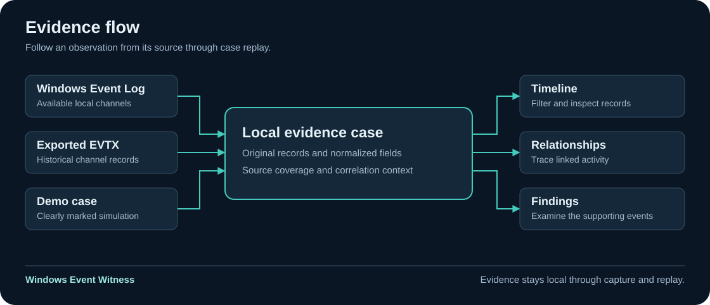
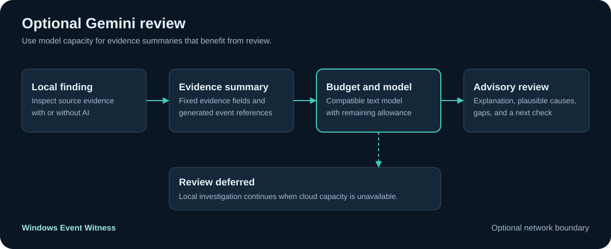

# Windows Event Witness

Windows Event Witness is a Windows desktop toolkit for investigating recorded endpoint activity. Collect recent events from local Windows logs or open an exported `.evtx`, then work through the timeline, relationships, and findings. A saved case can be reopened on another workstation for evidence review.

**Author** · Nipun Dilshan Senevirathne  
**Platform** · Windows 11 x64  
**Interface** · Native WPF desktop application

## Start here

1. Extract the complete Windows x64 release ZIP. Open `packaging\Install.cmd` for a per-user installation, or run `WindowsEventWitness.exe` directly from the extracted folder.
2. Follow the three-step walkthrough. **Skip walkthrough** or **Finish** opens the local investigation tools. The final page also offers **Connect Gemini**. You can reopen the guide with **Walkthrough**.
3. Choose **Open example case** in the walkthrough or **Load example case** in the app to explore the built-in simulation. The example contains six records for a test application, a worker, a file, and a local connection. An intentionally missing parent shows how the app presents uncertain relationships.
4. Choose **Collect recent events** for local channels or **Import EVTX** for an event log exported from a system you are authorized to investigate.
5. Select **Save case**, then verify the result with **Open case**. To compare it with another recording, open **Compare** and select a baseline case.

To make a small EVTX sample from the local System log, run the following in PowerShell on a machine where you have access to that log. The query exports records from the past hour. Open the resulting file in Windows Event Witness. [Microsoft `wevtutil`](https://learn.microsoft.com/en-us/windows-server/administration/windows-commands/wevtutil)

```powershell
$eventWitnessExport = Join-Path (Get-Location) 'system-last-hour.evtx'
wevtutil epl System $eventWitnessExport '/q:*[System[TimeCreated[timediff(@SystemTime) <= 3600000]]]'
```

## Evidence flow



| View or action | Use it to answer |
|---|---|
| Timeline | What did the selected source record, and in what order? |
| Relationships | Which process or event is connected, and what supports the connection? |
| Findings | Which records merit review, and which observations support the finding? |
| Evidence details | What timestamp, provider, event ID, and data did Windows report? |
| Case comparison | Which event types appear more or less often than in the selected baseline? |
| Case replay | Can another analyst reproduce the view and inspect the same evidence? |

The application uses the Windows Event Log reader for local channels and EVTX files. It retains the original rendered XML alongside a small set of normalized fields. The timeline uses UTC and a stable ordering so the same event set replays consistently. Correlation and findings are computed from that evidence on the desktop. [Windows Event Log queries](https://learn.microsoft.com/en-us/windows/win32/wes/querying-for-events)

### Windows sources

| Source | What can appear | What determines coverage |
|---|---|---|
| `Microsoft-Windows-Sysmon/Operational` | Process creation and configured network, file, and Registry events | Whether Sysmon is enabled, which event types its configuration includes, and log retention |
| `Security` | Security audit records such as process creation and logon activity | The workstation's audit policy, channel permissions, and log retention |
| `System` | Service and other operating system activity | Provider logging, channel permissions, and log retention |
| `Application` | Events written by installed software | The application's logging configuration and log retention |
| `Microsoft-Windows-Windows Defender/Operational` | Defender configuration and detection records | The endpoint's Defender configuration and channel permissions |
| Exported `.evtx` | Historical records already written to the export | The channels, time range, and filters used when creating the export |
| Built-in demo | Simulated observations for walking through the workflow | The records shipped with the application |

Sysmon process records can carry a Process GUID, which is a stronger correlation key than the numeric process ID by itself. In Security event `4688`, `NewProcessId` is the newly created process, and the event data's `ProcessId` is the creator. Event source, computer, and time all matter when comparing numeric IDs. [Sysmon event reference](https://learn.microsoft.com/en-us/sysinternals/downloads/sysmon), [Microsoft Security event 4688](https://learn.microsoft.com/windows/security/threat-protection/auditing/event-4688)

The Relationships view labels a link **Observed** when the recorded Sysmon identifiers identify a unique preceding process start on the same recorded computer. A missing or ambiguous start, or a parent ID without enough identity context, appears as **Uncertain**. Source Coverage reports records read and why a channel was clipped, partial, disabled, missing, or unavailable. Collection reads from local logs with the current account's access to those logs.

**Collect recent events** defaults to the last 24 hours and 1,000 records per selected channel. The dialog offers windows from one hour to seven days and per-channel caps from 250 to 2,000 records. If a cap is reached, the app keeps the newest records and labels the source **Clipped**. Preserve a full EVTX export separately when retention and the original event container matter.

### Reading a finding

Start with its supporting records. Check the computer, channel, provider, event ID, and time range. Follow each relationship to see the observations it uses. An observed process creation and a nearby event are still separate facts until the available fields support a link. Missing evidence can come from audit policy, Sysmon filtering, log rollover, access restrictions, or a narrow collection interval.

An unavailable or empty source cannot establish that an action did not happen. Likewise, a difference between two cases is a difference in the evidence collected. Compare channel coverage, time windows, and provider configuration alongside event counts before interpreting behavioral change.

| Local finding | Interpretation and first check |
|---|---|
| Audit log cleared | A provider recorded a log-clearing operation. Check the actor and any approved maintenance. |
| Service installed | Windows recorded service installation. Compare the service details and timestamp with approved software changes. |
| Security configuration changed | Windows reported a configuration change. Compare the recorded values and context with expected policy. |
| Detection reported | Microsoft Defender recorded a detection. Inspect its classification and subsequent remediation records. |
| Process chain | The captured evidence could not establish a process origin. Check for earlier process-creation records and compare the capture interval. |

### Saving and sharing a case

Each `.wew` case contains the collection time, source coverage, and Windows event XML. The app verifies a SHA-256 checksum on reopen and rebuilds normalized records from the saved XML. This detects accidental changes and a number of inconsistent edits. To authenticate where an export came from, preserve the original source separately and record who collected it and how it was handled. Case files may contain personal or operational data. Store and share them under the same access controls as the underlying records. [NIST SP 800-86](https://csrc.nist.gov/pubs/sp/800/86/final)

The app accepts case files up to 64 MiB. Smaller capture windows keep large investigations easier to replay. Keep the original EVTX separate when you are working on evidence that must be independently verified.

## Optional Gemini review



1. Choose **Connect Gemini** in the walkthrough or open **Settings**. Paste a Gemini API key into the masked field and choose **Test connection**.
2. Select the allowed models and a **Preferred review model**. Choose **Save changes**. Settings shows this app's requests for each model today. **Disconnect** removes the saved key.
3. Select a finding and open the **Gemini** tab in the Evidence Inspector. Preview the limited summary and choose **Review with Gemini**. The review can suggest plausible causes, gaps, and verification steps. Returned evidence references open the supporting records.
4. Turn on **Automatically review high-priority findings** to opt into background review for eligible findings. The source records and local findings remain available offline.

The request contains the finding type, priority, evidence count, and up to 12 fixed observation labels and event categories. References such as `E1` map back to case records locally. Raw event XML, private paths, command lines, account names, and endpoint identifiers stay in the case. The request disables API-side interaction storage and does not use grounding or tools. The API key is stored in Windows Credential Manager. Google's data-use terms still apply to traffic sent through the API. [Gemini API terms](https://ai.google.dev/gemini-api/terms), [Interactions storage](https://aistudio.google.com/docs/interactions-overview#data-storage-retention), [Windows Credential Manager API](https://learn.microsoft.com/en-us/windows/win32/api/wincred/)

### Models and capacity

The quota profile below comes from the supplied AI Studio limits. It describes a specific project's starting configuration. The app intersects this profile with model discovery for the connected key. Google can change model availability or account limits. [Gemini model discovery](https://aistudio.google.com/api-reference/models/list-models)

| Text model shown in AI Studio | RPM | Input TPM | RPD | Suggested use |
|---|---:|---:|---:|---|
| Gemini 3.5 Flash Lite | 15 | 250,000 | 500 | First automatic choice when available |
| Gemini 3.1 Flash Lite | 15 | 250,000 | 500 | Next automatic choice when available |
| Gemini 2.5 Flash Lite | 10 | 250,000 | 20 | Limited manual capacity |
| Gemini 2.5 Flash | 5 | 250,000 | 20 | Manual second review |
| Gemini 3 Flash | 5 | 250,000 | 20 | Manual second review |
| Gemini 3.6 Flash | 5 | 250,000 | 20 | Manual second review |
| Gemini 3.8 Flash | 5 | 250,000 | 20 | Manual second review |
| Gemini 4 Hydrogen | 5 | 250,000 | 20 | Manual second review |

RPM is requests per minute. Input TPM is input tokens per minute. RPD is requests per day. Google's published limits apply to the project, so usage from other apps sharing that project can consume capacity that this desktop app cannot observe in advance. Daily request limits reset at midnight Pacific time. [Gemini limits](https://ai.google.dev/gemini-api/docs/rate-limits), [Gemini model discovery](https://ai.google.dev/api/models)

### Preserving capacity

1. Automatic review handles up to four high-priority finding types per open case. The defaults cap app-wide requests at 12 per rolling minute and 150 per Pacific day. Automatic review stops once app-wide usage reaches 120 that day. Each model keeps 20% of its daily allocation, with a minimum of three requests, available for manual review.
2. An identical normalized summary and model reuse a result from the running app's cache when available. The app reserves an estimated input token allowance before sending and persists the usage ledger across restarts.
3. A model-specific quota response can route to a compatible, selected model with capacity. Shared or unclear throttling pauses cloud requests. Service unavailability honors `Retry-After` when supplied. A review has at most two network attempts. Local investigation can continue during cooldowns.
4. Change the preferred model under **Settings** to control the first choice for subsequent reviews or choose **Review with preferred model** to revisit the active finding. The app can account for requests it makes. Usage elsewhere in the same Google project can still exhaust the provider quota.

Audio, image, embedding, live session, agent, and Decisions API quotas belong to different workloads. They are outside this text-review profile.

## Distribution

The release has a self-contained .NET 10 x64 executable and an installation ZIP with the same program, installer, uninstaller, and illustrated guide. The build enforces a strict 100,000,000-byte limit on both artifacts. This release is unsigned. Check its SHA-256 digest against the published checksum. GitHub blocks regular repository files above 100 MiB and supports distributing binaries through Releases. [GitHub file limits](https://docs.github.com/repositories/working-with-files/managing-large-files/about-large-files-on-github), [GitHub Releases](https://docs.github.com/repositories/releasing-projects-on-github/about-releases)

The bundled runtime is covered by the [Microsoft .NET license](docs/dotnet/LICENSE.txt) and [third-party notices](docs/dotnet/ThirdPartyNotices.txt).

The installer copies the program into `%LOCALAPPDATA%\Windows Event Witness\Program`, adds Start menu shortcuts for the app and uninstaller, and opens the app. Close the app before reinstalling or removing it. Use **Uninstall Windows Event Witness** from the Start menu or run `packaging\Uninstall.cmd` from the extracted release. Uninstall keeps local data, saved cases, and the key in Windows Credential Manager. To remove the saved key, use the app's credential settings before uninstalling.

### Build from source

Use an x64 Windows development machine with the .NET 10 LTS SDK. From the project directory, run the build script. [Microsoft .NET 10 download](https://dotnet.microsoft.com/download/dotnet/10.0), [.NET support policy](https://dotnet.microsoft.com/en-us/platform/support/policy/dotnet-core)

```powershell
.\Build.ps1
Get-ChildItem .\dist | Select-Object Name, Length
Get-Content .\dist\SHA256SUMS.txt
```

`Build.ps1` puts `WindowsEventWitness.exe`, `Windows-Event-Witness-win-x64.zip`, and `SHA256SUMS.txt` in `dist` by default. Compare the checksums with a trusted copy if you distribute or verify a release.

### Verify the evidence workflow

The smoke test checks that the simulated case reopens with the same original records and relationships, that edited case content fails checksum verification, and that unsupported XML constructs are rejected.

```powershell
dotnet run --project .\tests\EvidenceSmoke\EvidenceSmoke.csproj --configuration Release
dotnet run --project .\tests\EvidenceSmoke\EvidenceSmoke.csproj --configuration Release -- --evtx .\system-last-hour.evtx
dotnet run --project .\tests\GeminiSmoke\GeminiSmoke.csproj --configuration Release
```

The second command uses an EVTX fixture to check Windows-backed event reads, original XML retention, and repeatable event identities.

The Gemini smoke test uses a simulated API and clock. It checks model discovery, request data filtering, local evidence references, caching, rate-limit routing, and quota behavior across app restarts and the Pacific-day reset. The harness runs without a live API key.

The standalone executable was launched on Windows x64 with its bundled runtime. The demo replay and both smoke suites passed. Windows denied live and EVTX reads in the test sandbox, so successful native collection and import need validation on an account that can read the selected source. Gemini integration was exercised with a mock service and remains to be verified with a connected key.

## Further reading

| For | Reference |
|---|---|
| Understanding the Windows record format and export behavior | [Windows Event Log tools](https://learn.microsoft.com/en-us/windows/win32/wes/windows-event-log-tools), [Windows event log command reference](https://learn.microsoft.com/en-us/windows-server/administration/windows-commands/wevtutil) |
| Viewing event logs with provider metadata and message resolution | [Microsoft EventLogExpert](https://github.com/microsoft/EventLogExpert) |
| Seeing local file, Registry, process, and thread activity interactively | [Microsoft Sysinternals Process Monitor](https://learn.microsoft.com/en-us/sysinternals/downloads/procmon) |
| Understanding the capabilities of a centrally managed endpoint monitoring and collection deployment | [Velociraptor overview](https://docs.velociraptor.app/docs/overview/) |
| Using a bring-your-own-key configuration | [Gemini API keys](https://ai.google.dev/gemini-api/docs/api-key), [Windows credential handling](https://learn.microsoft.com/en-us/windows/win32/secbp/handling-passwords) |
